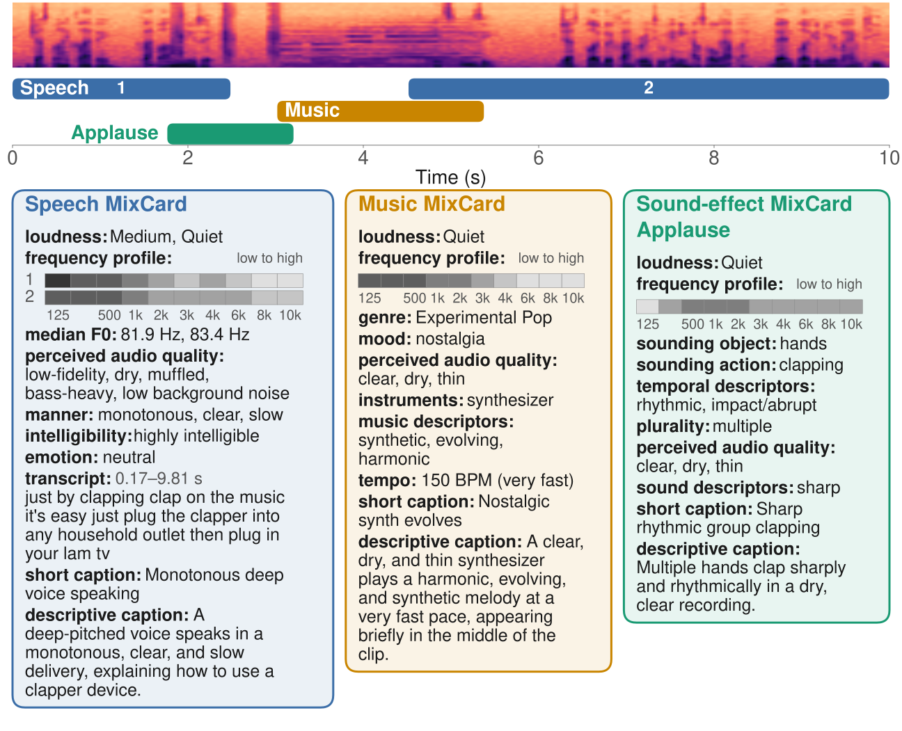
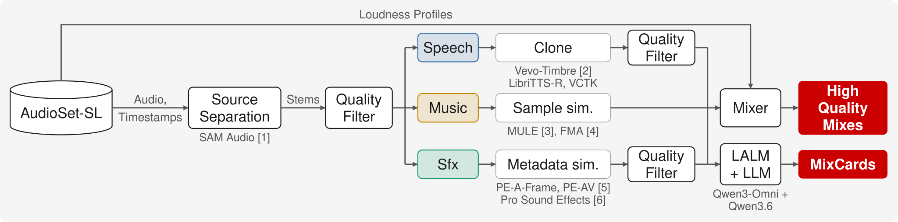

# MixCards: Evaluating Structured Descriptions of Multi-source Sound Scenes

[**Demo**](https://mixcards-anon.github.io/mixcards-demo/)

This repo includes evaluation code for MixCardBench, a benchmark dataset for structured descriptions of multi-source sound scenes.

## Overview



Each scene is a 10 s clip containing a combination of speech, music and sound effects sources. Each 
source has a corresponding MixCard, which is its structured description containing domain-specific fields. The example above shows a scene with speech, a short music clip and applause, along with their corresponding MixCards.

## Dataset creation



Scenes are built from AudioSet-SL clips and their timestamps. Domain-specific synthesis pipelines are applied to create high-quality mixes:

- Speech is cloned into a new voice from LibriTTS-R or VCTK with Vevo-Timbre [2].
- Music is replaced with the most similar FMA [4] track, based on MULE [3] embeddings.
- Sound effects are replaced with Pro Sound Effects [6] clips, based on metadata similarity with
  PE-A-Frame and PE-AV [5].

Cloned speech and sound effects are filtered to retain only high-quality sources. 
MixCards are generated by carefully prompting Qwen3-Omni and Qwen3.6.

## Metrics

### Stage 1: Sound event detection

Predicted sources are first matched to reference sources.

- Speech is matched to speech, and music is matched to music.
- Sound effects are matched by an LLM judge. The judge rates the similarity of each predicted
  source to each reference class.
- The scorer keeps the best one-to-one assignment. A pair counts as a match only if its
  similarity is at least 0.5.

Matched sources are then scored with sound event detection F1.

- Segment-based F1 compares activity in 100 ms segments.
- Event-based F1 compares onsets and offsets with a 1.0 s collar.
- F1 is reported for each source type and overall.

### Stage 2: Structured descriptions per source

Each matched card is scored field by field, ranging from 0 to 1.

| Field | Score |
|---|---|
| loudness, plurality | 1 - ordinal distance / (scale length - 1) |
| frequency_profile | mean over bands of 1 - ordinal distance / 6 |
| median_f0_hz | max(0, 1 - semitone error / (4 x 5.19)) |
| tempo | tempo label as an ordinal (very slow ... very fast) |
| tag fields | judge-itemized soft F1; a broader, narrower or related tag counts half |
| captions | judge rubric mean (correctness, relevance, completeness, clarity); short_caption also scaled by a 4-word length target |

- A blank or invalid answer scores 0.
- A field that is blank in the reference is skipped.
- A card's score is the mean of its field scores.
- The Stage 2 score is the mean card score over all matched cards.

## Install

Requires Python 3.12+.

Local vLLM judge (default, used for the reported results). Requires an NVIDIA GPU with driver>= 580. No system CUDA toolkit is needed.

```bash
conda env create -f environment.yml        # python 3.12 + requirements-vllm.txt + this package
conda activate mixcards-eval
```

or

```bash
pip install -r requirements-vllm.txt
pip install -e .
```

API judge only (OpenAI, Gemini, or a remote `vllm serve` endpoint). No GPU needed.

```bash
pip install -r requirements.txt
pip install -e .
```

## Evaluation 

### 1. Inference

```python
from mixcards_eval import merge_sources, parse_card, parse_inventory, stage1_messages, stage2_messages

answer = my_model(audio, stage1_messages())                  # attach the scene audio your model's way
sources = merge_sources(parse_inventory(answer))              # all speech -> one source, all music -> one
cards = [{"type": s["type"], "name": s["name"],
          "card": parse_card(my_model(audio, stage2_messages(s["type"], s["name"])))}
         for s in sources]
row = {"eid": eid, "sources": sources, "cards": cards}        # one line of predictions.jsonl
```

The prompts are text only. Pass the full scene audio with every call.

Each line of `predictions.jsonl` looks like this:

```json
{"eid": "--BfvyPmVMo_20000",
 "sources": [{"type": "speech" | "music" | "sound effect", "name": "machine operation",
              "spans": [[0.0, 7.1]]}],
 "cards": [{"type": "sound effect", "name": "machine operation", "card": {...} | null}]}
```

`card` can be a dict, raw model output, or `null`. A `null` card scores as blank. Sources with no
spans are ignored.

### 2. Metrics

The default judge is `meta-llama/Meta-Llama-3-8B-Instruct` on vLLM.

```bash
mixcards-eval --dataset <hf id | local dataset dir | rows.jsonl> --split final_4884 \
    --predictions predictions.jsonl --out results.json [--per-card per_card.jsonl]
```

OpenAI-compatible endpoints are supported but less tested:

```bash
--judge-backend openai --judge gpt-4o-mini                                      # OPENAI_API_KEY
```

Each dataset row looks like this:

```json
{"eid": "--BfvyPmVMo_20000", "audio": <audio>, "duration": 10.0,
 "sources": [{"type": "speech" | "music" | "sfx", "label": "Hand", "spans": [[3.007, 3.657]]}],
 "cards": {"speech": {<field>: <value>} | null, "music": {...} | null,
           "sfx": [{"class": "Hand", <field>: <value>}]}}
```

Reference cards keep only the fields the scorer compares (see `mixcards_eval.format.reduce_card`).

## License

This code is released under the [MIT License](LICENSE).

## References

1. Shi et al., "SAM Audio: Segment Anything in Audio," ICML 2026.
2. Zhang et al., "Vevo: Controllable Zero-Shot Voice Imitation with Self-Supervised Disentanglement," ICLR 2025.
3. McCallum et al., "Supervised and Unsupervised Learning of Audio Representations for Music Understanding," ISMIR 2022.
4. Defferrard et al., "FMA: A Dataset for Music Analysis," ISMIR 2017.
5. Vyas et al., "Pushing the Frontier of Audiovisual Perception with Large-Scale Multimodal Correspondence Learning," CVPR 2026.
6. Pro Sound Effects, "Pro Sound Effects Library," prosoundeffects.com, 2026.
